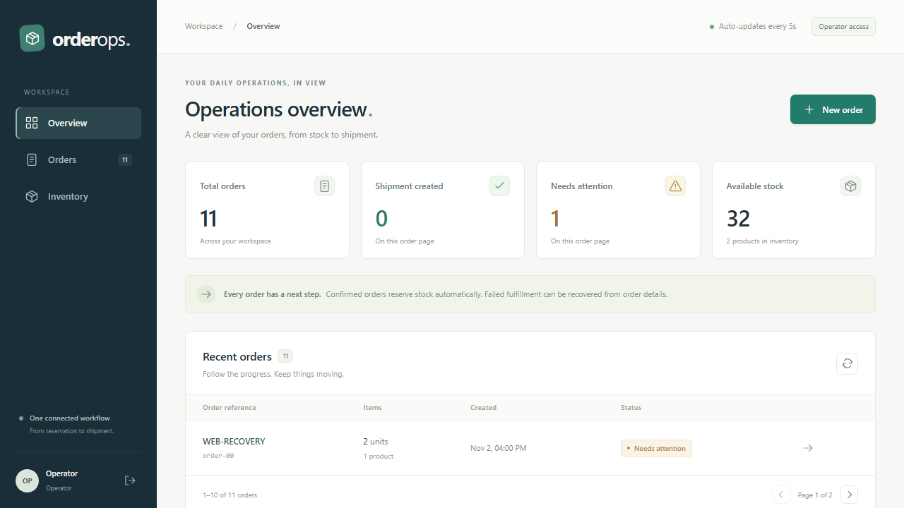
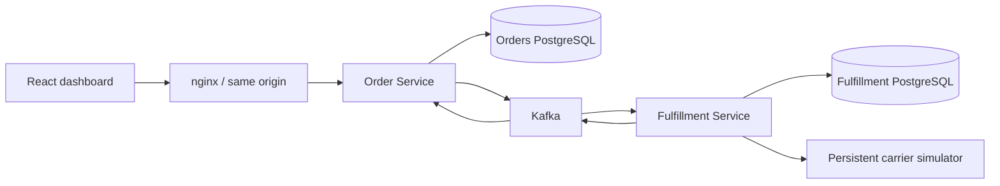

# OrderOps

A retail operations product demonstrating Java/Spring architecture, reliable messaging and failure recovery. Operators reserve stock, create shipments and recover carrier outages; viewers inspect the workflow without changing it.



## Architecture



Order Service owns inventory, reservations, orders, timeline, actor-scoped idempotency and its outbox. Fulfillment owns durable generation jobs, leases, attempts, consumed-event deduplication, shipments and its result outbox. Services never read each other's tables. One PostgreSQL server hosts separate databases/roles locally. The simulator is an external HTTP dependency with reproducible failures.

Applications use Java21, Spring Boot, Maven, PostgreSQL/Flyway and Spring Kafka. React/TypeScript provides the dashboard; production serves static assets through nginx. Payments, public signup, cancellation, delivery tracking and multiple retailers are outside scope.

The workspace contains `orderops/backend` and `orderops/frontend`. The [frontend](../frontend/README.md) has its own Git repository, tests, and CI. This backend repository owns Java services, contracts, and stack orchestration. Run the commands below from `orderops/backend`. See the [separation decision](docs/adr/0001-separate-frontend-project.md).

## Implemented behavior

- Authenticated create/read/list orders and inventory, viewer/operator roles, sessions and CSRF.
- Strict address/quantity validation, canonical fingerprints, same-key transaction serialization and safe request replay.
- Sorted inventory locks and atomic order/reservation/outbox writes.
- Versioned events, durable consumer deduplication, acknowledged outbox publication and dead lettering.
- Persistent shipping jobs, expiring leases, bounded retries and stable carrier keys.
- Manual recovery, timeline and tracking references; stale failures cannot downgrade newer success.
- Responsive dashboard with viewer controls, uncertain-request recovery and polling that preserves drafts.
- Complete Compose, CI, API/event contracts, Postman collection and AWS deployment materials.

## Run locally

Requires Java21+, Maven3.6.3+, running Docker/Compose, and dependency access. Frontend development needs Node22.12+; container builds provide Node.

```powershell
Copy-Item .env.example .env
mvn verify
docker compose --env-file .env -f infra/compose.yaml -f infra/compose.frontend-build.yaml --profile apps up -d --build
```

Open **http://localhost:8088**. Demo accounts: `operator` / `operator-local-only` and `viewer` / `viewer-local-only`. Local seed: COFFEE10, TEA5, MUG1. Restarting does not replenish stock. These are local fixtures, not deployment credentials.

Local ports: Order API8080, Fulfillment8081, carrier8090, PostgreSQL5433, external Kafka19092. Host bindings are loopback-only; containers use private service networking.

The command above expects the frontend checkout at `../frontend`. Set `ORDEROPS_FRONTEND_PATH` to an absolute path for another location. To use a prebuilt image instead, set `ORDEROPS_FRONTEND_IMAGE` and omit `-f infra/compose.frontend-build.yaml`.

For development, start dependencies with Compose, run each Java application using `-Dspring-boot.run.profiles=local`, then run `npm ci` and `npm run dev` inside `../frontend`. The Node development server serves loopback5173 and proxies API/session requests to8080. Read the [development-tool notes](docs/SECURITY.md) before using that server.

## API and recovery

Import the [Postman collection](contracts/OrderOps.postman_collection.json) and run **Foundation API**. Its separate **Recovery** folder expects an order whose automatic retries are exhausted. The [OpenAPI contract](contracts/openapi.yaml) documents exact payloads.

Fetch `/api/csrf`, POST form credentials to `/login`, then fetch a fresh CSRF token using the same session. Order creation and retry require `X-CSRF-TOKEN` and `Idempotency-Key`. A new order returns201; exact replay200; conflicting key reuse409. Retry returns202 or200 for replay.

```json
{
  "customerReference": "DEMO-1",
  "shippingAddress": {"recipient":"Ada Lovelace","line1":"10 Example Street","city":"London","postalCode":"SW1A 1AA","country":"GB"},
  "demoScenario": "FAIL_THEN_RECOVER",
  "items": [{"sku":"COFFEE","quantity":1}]
}
```

After an uncertain response, resend the **same key and payload**. The dashboard preserves unresolved requests in actor-scoped session storage. Recovery creates a new generation while retaining the carrier key and reserved stock.

| Scenario | Expected behavior |
| --- | --- |
| NORMAL | Shipment accepted and order reaches SHIPMENT_CREATED. |
| FAIL_THEN_RECOVER | Three carrier failures exhaust attempts; operator retry starts a new generation and succeeds. |
| TIMEOUT_AFTER_CREATE | Carrier creates once and loses its first response; retry returns the stored shipment. |

SHIPMENT_CREATED does not imply physical dispatch. See the [five-minute demo](docs/DEMO.md).

## Verification and current limits

```powershell
mvn verify
node --test tools/carrier-simulator/test/server.test.mjs
cd ../frontend
npm test
npm run build
npm run test:ui
$env:ORDEROPS_E2E_URL='http://127.0.0.1:8088'
npm run test:e2e
```

Latest local verification: **79 Java core/HTTP/logging tests**, default-profile Kafka compilation and executable packaging, **7 simulator tests**, **8 frontend client/proxy tests**, **6 isolated browser journeys**, a clean cached frontend install and production build pass. Compose, CI YAML and Linux script syntax validate. JSON logs include request correlation and durable order/event identifiers; see [observability](docs/OBSERVABILITY.md).

The historical 2026-11-02 run passed 83 Java tests including PostgreSQL/Kafka and an unmocked full-stack journey. That result predates the current changes. Current `mvn verify` stops at unavailable Failsafe dependencies, and Docker API access is denied. AWS and hosted CI have not run for this release.

`mvn -Poffline test` excludes Kafka adapter sources/tests to exercise cached core dependencies. Offline package names/manifests identify verification-only artifacts; deployment rejects them. This profile does not validate a Kafka release. This machine additionally needs Java21 selected, inherited malformed MAVEN_OPTS cleared and ignored task-local Maven mirror settings; global configuration is unchanged.

Vite was removed in favor of esbuild and a loopback Node development proxy. The latest successful audit passes the high-severity gate with one low esbuild advisory remaining; its affected serving API is not used. A patched package download was denied. [Security notes](docs/SECURITY.md) record the finding and scope.

The [release ledger](.scratch/orderops/release-completion.md) distinguishes delivered source from pending acceptance. A real-stack video recorder, checksummed backups and a disposable restore check are ready to run when infrastructure is available. They are not represented as executed deployment evidence.

## Documents

- [Architecture](docs/superpowers/specs/2026-11-02-orderops-design.md), [specification](.scratch/orderops/spec.md), [implementation contract](.scratch/orderops/implementation-contract.md)
- [Tickets](.scratch/orderops/issues/), [domain language](CONTEXT.md), [contributing](CONTRIBUTING.md)
- [Requirement evidence](docs/JAGAAD-SKILLS.md), [event schema](contracts/events.schema.json), [API contract](contracts/openapi.yaml)
- [Operations](docs/OPERATIONS.md), [AWS deployment](docs/DEPLOYMENT.md), [security](docs/SECURITY.md)
- [Execution evidence/blockers](.scratch/orderops/completion-progress.md)
