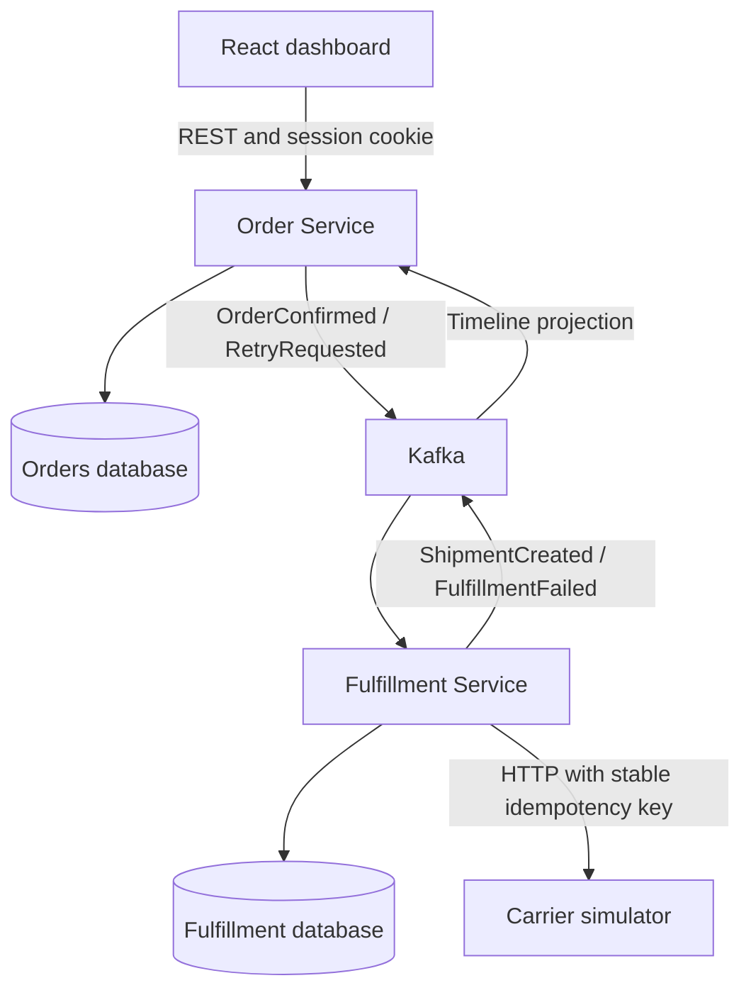

# OrderOps architecture design

The user approved the two-service architecture and feature-oriented Java structure in conversation. The canonical product requirements are in [the specification](../../../.scratch/orderops/spec.md).

## Intent

Demonstrate Java/Spring engineering through a retail workflow whose correctness and failure recovery can be shown to Jagaad reviewers in a short demo.

## Approaches

1. Modular monolith: simplest operations, but weaker evidence of distributed messaging.
2. Two services (chosen): Order Service owns orders and inventory; Fulfillment Service owns carrier work. This provides meaningful integration boundaries within one week.
3. Many small services: increases distributed consistency and operational work beyond the initial portfolio scope.

## Components and ownership

Orders and inventory use one transaction. Fulfillment never reads Order Service tables. Each service owns its outgoing outbox, deduplication data and migrations. The dashboard reads the Order Service projection and initially polls for updates.

## Reliability

Order creation locks inventory rows in sorted SKU order, reserves all requested stock, saves the order and writes an outbox record in one transaction. Outbox publishing is at least once. Consumers deduplicate by event ID in the same transaction as durable business effects. A shipping worker runs external calls outside transactions, reusing a carrier idempotency key derived from the order. Result events include attempt generation to reject stale failure results. Failed fulfillment retains stock for recovery.

## Internal structure

Each Java application has its own Maven module and boot entry point. Business feature packages contain controllers, DTOs, application services, JPA repositories and domain entities. Messaging adapters and configuration have dedicated packages. Application services coordinate transactions; entities enforce stock and status rules. Resources contain profile properties and Flyway migrations. Only create implemented components; do not add empty classes to imply finished functionality.

## Security

Same-origin deployment, server-side sessions, CSRF tokens, viewer/operator roles and environment-supplied credentials. Local-only demo defaults are documented. Health endpoints expose status without database details. Internal infrastructure remains private. Application logs avoid request bodies and credentials.

## Scope and constraints

See the specification for the agreed one-week scope. Build the API foundation first; fulfillment, messaging, React and AWS follow as explicit milestones. No cloud resources are created in the foundation. One-host deployment is a reproducible demo rather than a high-availability claim.

## Builder choices

The builder selects DTO mapping details, migration column lengths, logging mechanics and test fixtures while preserving the specified API validation and transaction semantics. First-milestone seed stock exists only in the local profile and tests.

## Verification

JUnit domain tests plus PostgreSQL-backed HTTP integration tests, followed by Kafka and browser coverage as those slices land. Validate rollback, duplicate SKU rejection, security and two buyers contending for the last item before claiming reservation correctness.
